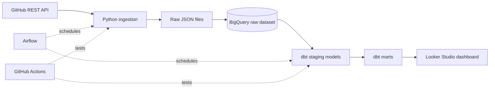

# Architecture

## Why fact_repo_daily has one row per repo per day

GitHub's API only gives the star and fork counts as of right now. If the table had one row per repo, each daily run would overwrite the previous number and the history would be lost. One row per repo per day keeps every snapshot, so the dashboard can show how stars and forks grow over time.